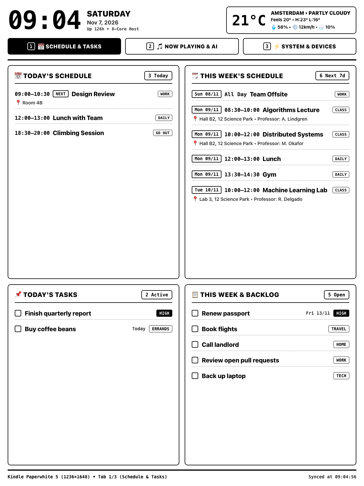
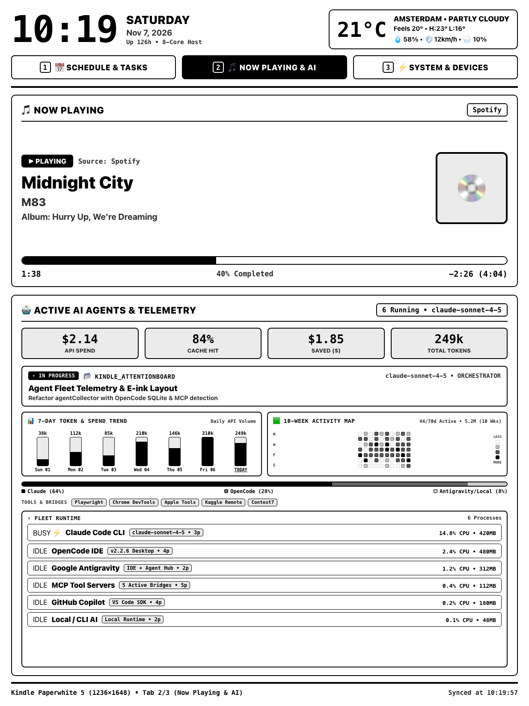
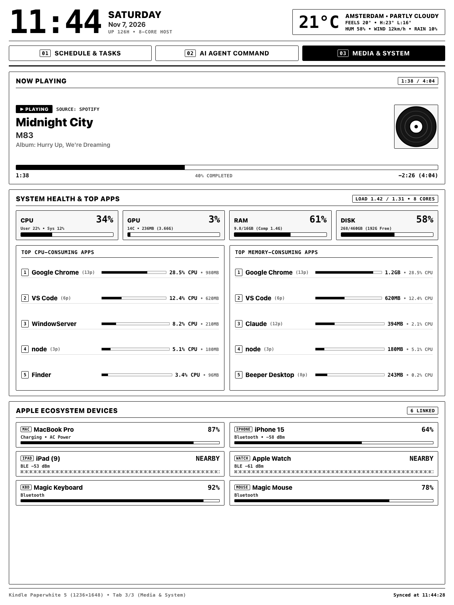

# Kindle AttentionBoard

A high-contrast, distraction-free ambient desk monitor and 3-tab attention dashboard for **jailbroken Kindle e-ink displays** (optimized for **Kindle Paperwhite 5 — `1236×1648`**) and desktop browsers. Built with Node.js, TypeScript, and native Swift helpers on macOS, tailored for the Apple ecosystem, multi-agent AI workflows, and personal productivity.

Inspired by [alexishida/kindle-dashboard](https://github.com/alexishida/kindle-dashboard).

---

## Screenshots

<table>
  <tr>
    <td align="center"><br><sub><b>Tab 1</b> — Schedule &amp; Tasks</sub></td>
    <td align="center"><br><sub><b>Tab 2</b> — Now Playing &amp; AI</sub></td>
    <td align="center"><br><sub><b>Tab 3</b> — System &amp; Devices</sub></td>
  </tr>
</table>

<sub>Rendered at `1236×1648` with `DEMO_MODE=1`: all names, events, devices, and metrics are fictional.</sub>

---

## 3-Tab Dashboard Layout (`1236×1648`)

Every tab shares a persistent top header (**Big Clock**, **Date & Host Uptime**, **Live Open-Meteo Weather** with temperature, feels-like, high/low, humidity, wind speed, and precipitation probability) and an interactive **3-Tab Switcher Bar**:

### Tab 1 — `📅 Schedule & Tasks` (Reminders & Calendar)
* **Today's Schedule**: Full daily timeline from Apple Calendar with `NOW` and `NEXT` status pills, room/location badges, professor/meeting notes, and calendar category tags.
* **This Week's Schedule (Next 7 Days)**: Upcoming 7-day lookahead with day/date pills (`Wed 04/11`) and time ranges.
* **Today's Tasks**: Actionable items due today, high-priority reminders, and `Todo` calendar deadlines.
* **This Week & Backlog**: Upcoming exams/tests from Calendar plus open items across Apple Reminder lists (`Todo`, `Groceries`, `Stuff`, `Nhắc nhở`, etc.).

### Tab 2 — `🎵 Now Playing & AI` (Separated Media & AI Fleet UI)
* **Now Playing (Pure Media Card)**:
  * Direct integration with the **YouTube Music Desktop App** HTTP API (`127.0.0.1:26538/api/v1/song` and `127.0.0.1:9863/query`), plus fallback to native macOS `MediaRemote` and AppleScript (**Spotify**, **Apple Music**).
  * Displays large track title, artist, album, high-contrast grayscale album cover art, playback status (`▶ PLAYING` / `⏸ PAUSED`), and progress bar with elapsed/remaining time.
* **Active AI Agents & Telemetry (Pure AI Card)**:
  * **Vorssaint-Style AI Economics Banner**: Aggregated daily API spend ($), prompt cache hit rate (%), dollars saved via caching ($), and total daily tokens from both OpenCode (`~/.local/share/opencode/opencode.db`) and Claude (`~/.claude/stats-cache.json`).
  * **Active Session & Task Focus**: Ambient glance of current project, active session title, in-progress step (`todo` table), active model, and agent role (`ORCHESTRATOR` / `BUILD`).
  * **📊 7-Day Token & Spend Trend Chart**: High-contrast daily bar chart of API token volume across the week with day labels (`Sun 01` ... `TODAY`).
  * **🟩 10-Week Activity Heatmap**: 70-day contribution grid (Mon–Sun) mapping daily coding activity levels (less → more) and 10-week totals.
  * **Provider Distribution Multi-Bar**: Proportional segmented bar visualizing the token/cost split between **Claude**, **OpenCode**, and **Antigravity/Local**.
  * **Active MCP Tool Bridges**: Real-time detection of external agent tools (e.g., `Playwright`, `Chrome DevTools`, `Apple Tools`, `Kaggle Remote`, `Context7`, `Code Review Graph`).
  * **⚡ Compact Fleet Runtime**: High-density list with status pills (`[BUSY ⚡]` vs `[IDLE]`), running processes, version/model details, process counts, CPU %, and RSS memory (MB) for:
    * **Google Antigravity**
    * **OpenCode IDE & Service Daemon** (`opencode-cli serve`)
    * **Claude Code CLI** (with active `--model` extraction)
    * **Claude Desktop**
    * **GitHub Copilot**
    * **Cursor / Windsurf / OpenAI Codex / Zed**
    * **Local / CLI AI** (`ollama`, `llama-server`, `mlx_lm`, `AionUi`)
    * **MCP Tool Servers**

### Tab 3 — `⚡ System & Devices` (Hardware Health, Top Apps & Apple Battery)
* **System Health (4 Hardware Gauges)**:
  * **CPU**: Real `top` / kernel tick utilization (`User %` + `Sys %`).
  * **GPU**: Apple Silicon `IOAccelerator` utilization %, GPU core count, active VRAM (MB), and allocated system memory (GB).
  * **RAM**: Accurate macOS memory footprint via `vm_stat` (`App + Wired + Compressor`) in GB and %.
  * **DISK**: APFS `/System/Volumes/Data` used, total, and free GB.
* **Top Resource-Consuming Apps**:
  * **🔥 Top CPU-Consuming Apps** & **🧠 Top Memory-Consuming Apps**: Top 5 applications each, aggregated across helper processes by `.app` bundle name.
* **Apple Ecosystem Devices Battery**:
  * Correlates `pmset`, `ioreg` HID `DeviceAddress`, `system_profiler SPBluetoothDataType`, and BLE proximity to display battery and link status for **MacBook Pro**, **Magic Keyboard**, **Mouse**, **AirPods Pro** (`L` / `R` / `Case` breakdown), **iPhone**, **iPad**, and **Apple Watch**.

---

## Architecture: Why Jailbroken Kindle + FBInk Wins

Instead of running Kindle's sluggish experimental WebKit browser (which drains the battery in hours), this project uses a client-server headless rendering pipeline:

1. **Mac Server (`http://0.0.0.0:8787`)**:
   - Collects all macOS, AI agent, calendar/reminder, media, Bluetooth, and weather metrics asynchronously.
   - Renders a high-contrast monochrome HTML/CSS view for the active tab (`1`, `2`, or `3`).
   - Generates and caches a crisp `1236×1648` PNG snapshot using headless Google Chrome.
   - Slices each snapshot into horizontal bands, hashes their pixels, and exposes a **tile manifest** so the Kindle can download only the bands that changed (`/dash/manifest`, `/dash/tile?i=N`). The full PNG remains available at `/dash.png` as a fallback.
2. **Kindle Client (`kindle/attentionboard.sh`)**:
   - Fetches `/dash/manifest` every `60s` and compares band hashes with the previous cycle.
   - Downloads only changed bands and composes them into the framebuffer with:
     ```sh
     fbink -q -b -g file="/tmp/tile.png",x=0,y=190
     ```
   - Refreshes **only the changed rectangles** (`fbink -s top=...,left=...,width=...,height=... -W GL16`), so a clock tick repaints ~12% of the panel instead of the whole screen.
   - If most of the screen changed, it falls back to fetching `/dash.png` and drawing it in one pass.
   - Performs a full flashing refresh (`-f`) every 30 cycles to eliminate e-ink ghosting.
   - Keeps the last good frame on screen if the Mac is unreachable, and only shows a "waiting for Mac" message after three consecutive failures.

---

## Quick Start on macOS

### 1. Requirements
* macOS (Apple Silicon or Intel)
* Node.js `>= 20` and `npm` (or `pnpm`)
* Google Chrome installed at `/Applications/Google Chrome.app`
* Xcode Command Line Tools (`swiftc` for compiling native Swift helpers in `src/native/`)

### 2. Installation & Build
```bash
# Install dependencies
npm install

# Compile native Swift helpers (bin/media-helper, bin/tasks-helper), TypeScript, and view assets
npm run build

# Run the collector & renderer test suite
npm test
```

### 3. Start the Server
```bash
# Start production server on port 8787
npm start

# Or run in development mode
npm run dev
```

Open `http://localhost:8787` in your browser to view the dashboard and switch tabs interactively.

---

## Switching Tabs

You can switch between the 3 tabs from any browser, via REST API, or directly from the Kindle:

1. **Browser UI (`http://localhost:8787` or `http://<MAC_IP>:8787`)**:
   * Click **1 • 📅 SCHEDULE & TASKS**, **2 • 🎵 NOW PLAYING & AI**, or **3 • ⚡ SYSTEM & DEVICES** in the top navigation bar.
   * Switching tabs in the browser automatically updates the active tab served to your Kindle via `/dash.png`.
2. **REST API / CLI**:
   ```bash
   # Pin a specific tab (1, 2, or 3)
   curl -X POST "http://127.0.0.1:8787/api/tab?tab=2"

   # Cycle to the next tab (1 -> 2 -> 3 -> 1)
   curl -X POST "http://127.0.0.1:8787/api/tab/next"

   # Enable automatic tab rotation on each Kindle refresh
   curl -X POST "http://127.0.0.1:8787/api/tab?autoCycle=true"
   ```
3. **Kindle Client (`attentionboard.sh`)**:
   ```sh
   /mnt/us/attentionboard.sh 1     # Switch to Tab 1 (Schedule & Tasks)
   /mnt/us/attentionboard.sh 2     # Switch to Tab 2 (Now Playing & AI)
   /mnt/us/attentionboard.sh 3     # Switch to Tab 3 (System & Devices)
   /mnt/us/attentionboard.sh next  # Cycle to next tab
   ```

---

## Deploying to Your Jailbroken Kindle

### Prerequisites on Kindle
1. A jailbroken Kindle with **KUAL** (Kindle Unified Application Launcher) or SSH/USBNetwork enabled.
2. **FBInk** installed (`/mnt/us/libkh/bin/fbink` or `/mnt/us/koreader/fbink`).

### Deployment via SSH
```bash
./kindle/install.sh <KINDLE_IP> <MAC_IP>
```
Then start the daemon on the Kindle:
```bash
ssh root@<KINDLE_IP> '/mnt/us/attentionboard.sh > /dev/null 2>&1 &'
```

### Client tuning (environment variables on the Kindle)

```bash
INTERVAL_SECONDS=60      # poll cadence
FULL_FLASH_EVERY=30      # full black-flash refresh every N cycles (ghosting)
WAVEFORM=GL16            # A2 = fastest/1-bit, GL16 = 16-gray, GC16 = cleanest
```

The client keeps its band-hash cache in `/tmp`, so a Kindle reboot triggers one
full redraw and normal cycles download only changed bands. If the installed
FBInk build lacks `-b/--norefresh`, the client automatically falls back to
drawing the full `/dash.png` each update.

---

## REST API Endpoints

| Endpoint | Method | Description |
| :--- | :--- | :--- |
| `GET /` | `GET` | Interactive HTML dashboard (`?tab=1\|2\|3` switches active tab) |
| `GET /render` | `GET` | Clean snapshot HTML view for headless Chrome (`?tab=1\|2\|3`) |
| `GET /dash.png` | `GET` | `1236×1648` PNG snapshot for Kindle (`?tab=1\|2\|3`, `?force=true`) |
| `GET /dash/manifest` | `GET` | Per-band tile manifest: `index x y w h hash` (`?tab=1\|2\|3`) |
| `GET /dash/tile` | `GET` | Single snapshot band as PNG (`?i=0..N`, `?tab=1\|2\|3`) |
| `GET /api/data` | `GET` | Full JSON telemetry payload + current `tabState` |
| `GET /api/tab` | `GET` | Returns current `{ activeTab, autoCycle }` state |
| `POST /api/tab` | `POST` | Set `tab` (`1`, `2`, `3`) and/or `autoCycle` (`true`/`false`) |
| `POST /api/tab/next` | `POST` | Advance to the next tab (`1 → 2 → 3 → 1`) |
| `POST /api/refresh` | `POST` | Force immediate snapshot re-render (`?tab=1\|2\|3`) |

---

## Configuration (`.env`)

```ini
PORT=8787
REFRESH_SECONDS=60

# Screen Resolution (Default: Kindle Paperwhite 5 / Oasis)
KINDLE_WIDTH=1236
KINDLE_HEIGHT=1648

# Band height for tile-diff updates (default: 190)
# TILE_HEIGHT=190

# Screenshots / UI work: serve fictional data instead of the host's real
# calendar, weather, media, and devices.
# DEMO_MODE=1
```

---

## License

MIT
